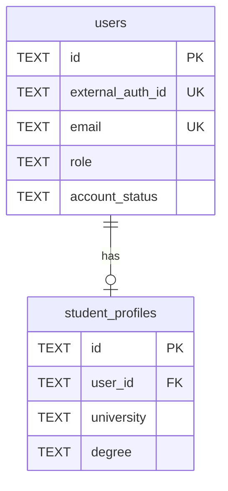
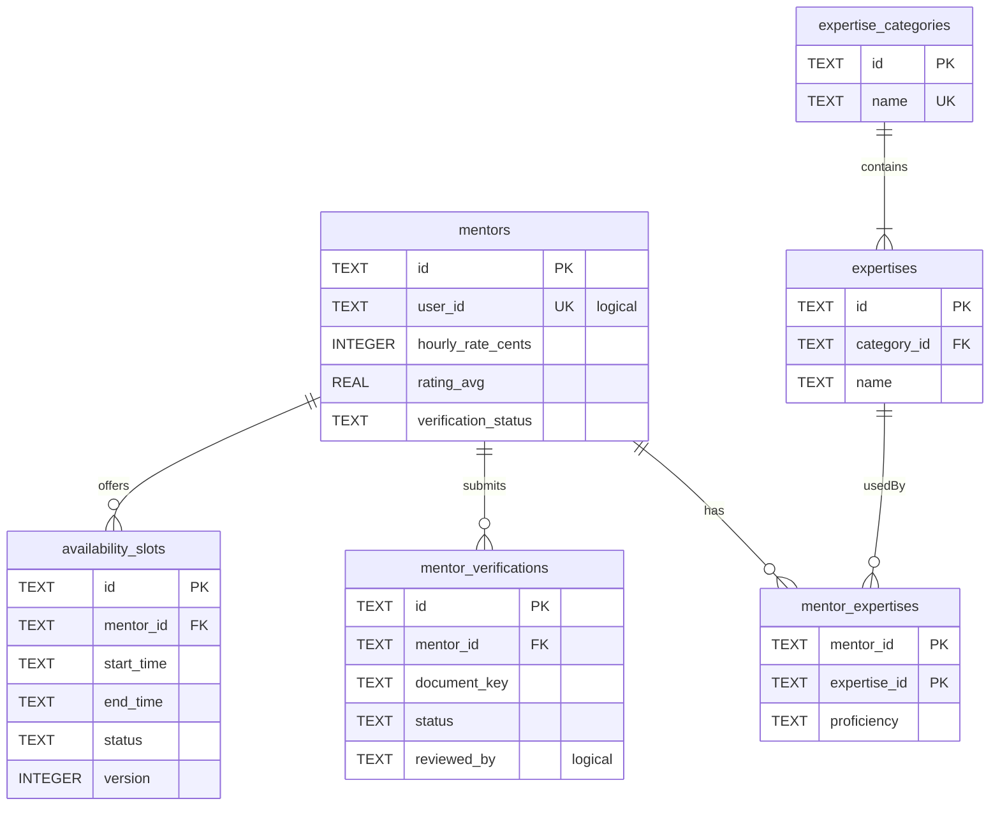
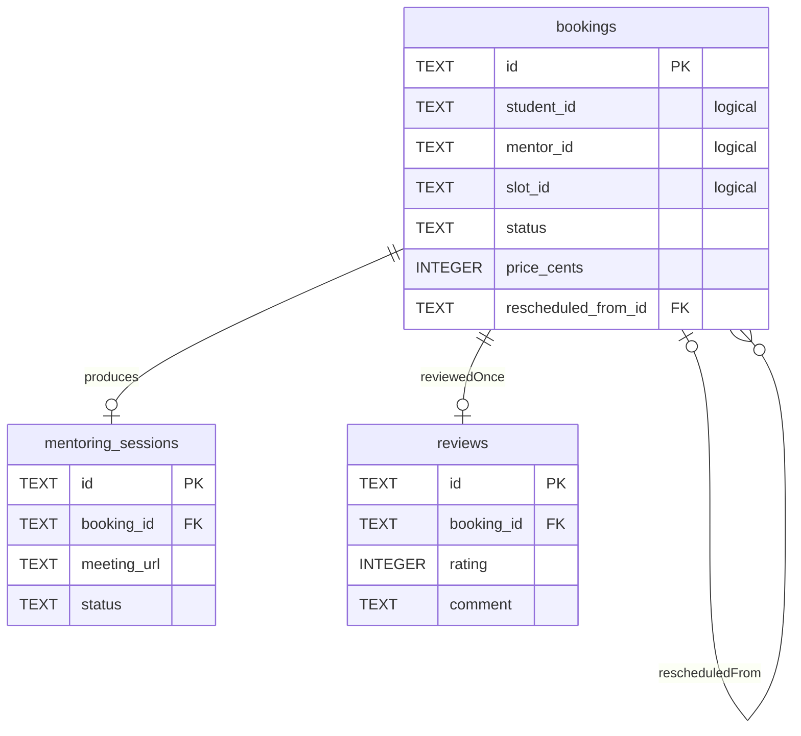
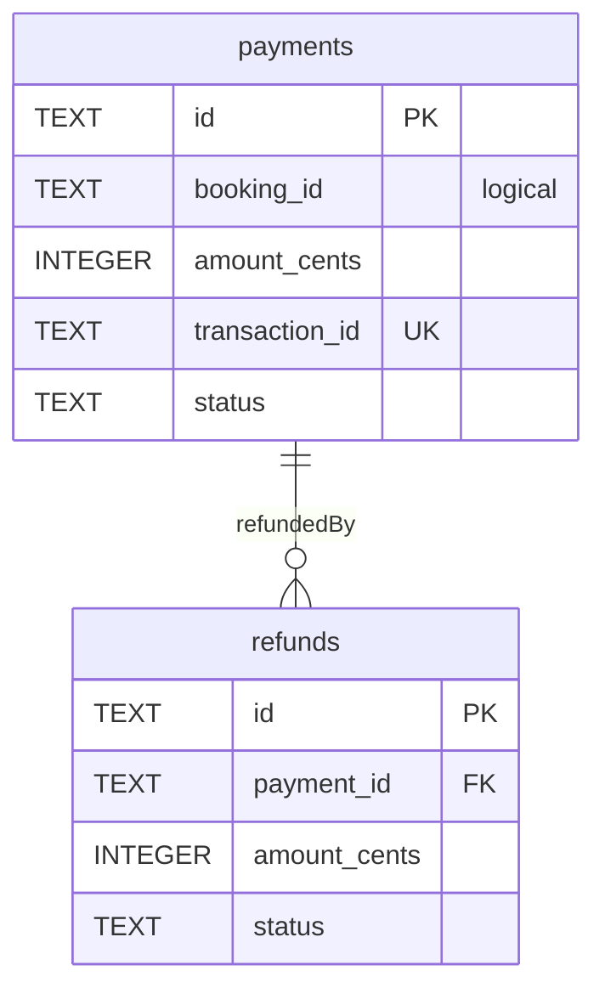
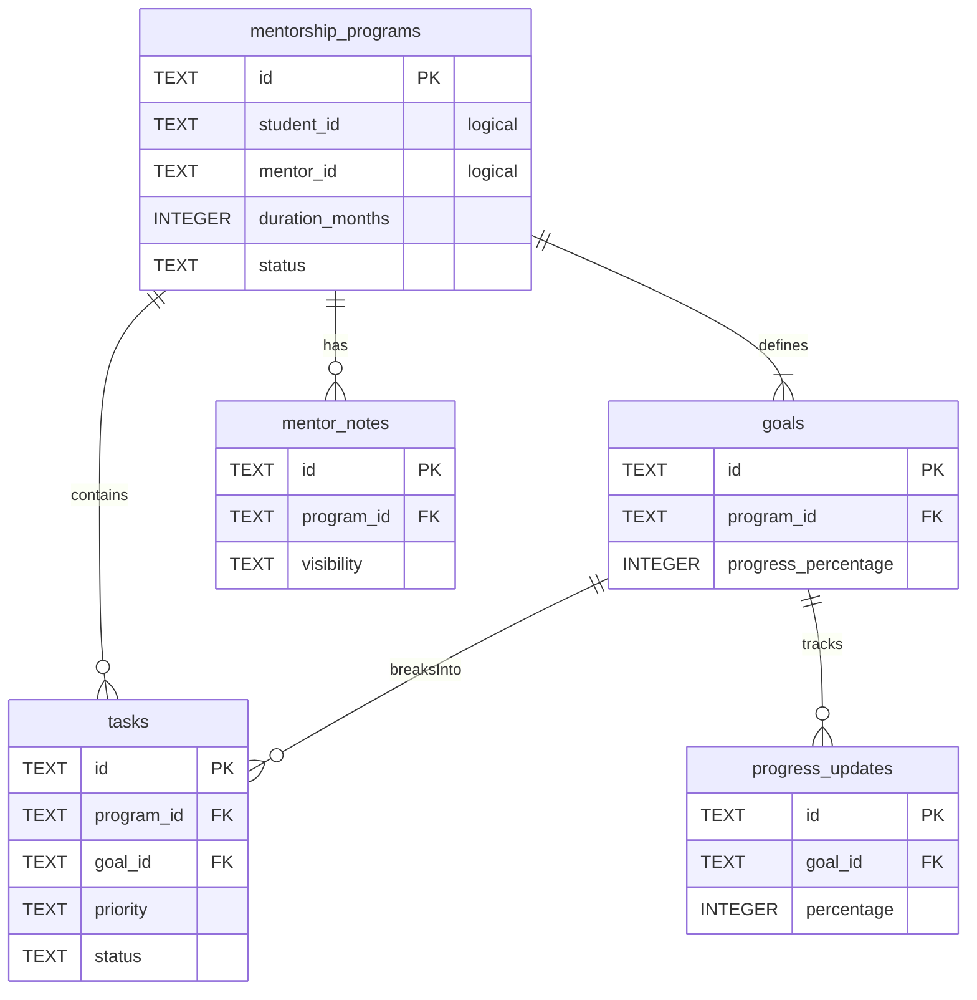
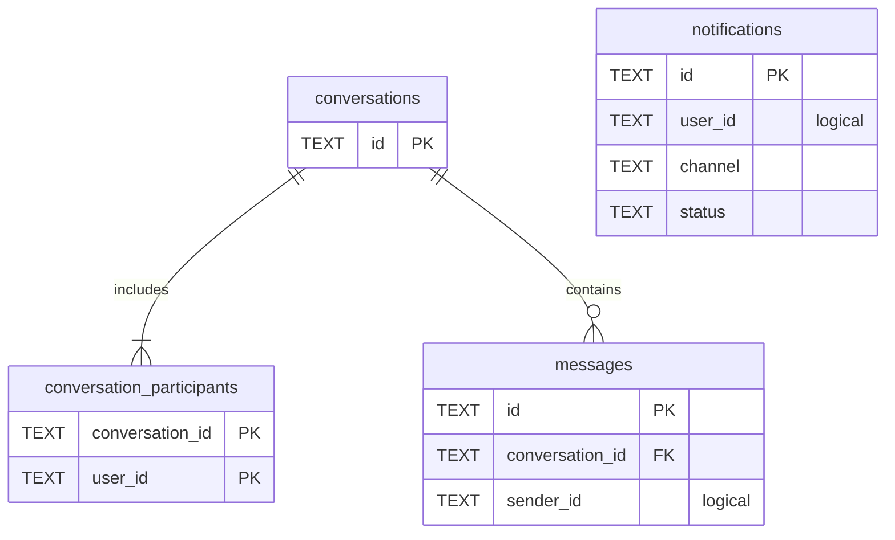
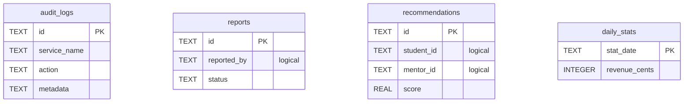

# MentorConnect ER Diagrams

Each service has its own SQLite file. `logical` means the id points to another service (no foreign key).

## user-service

## mentor-service

## booking-service

## payment-service

## mentorship-service

## notification-service

## analytic-service

